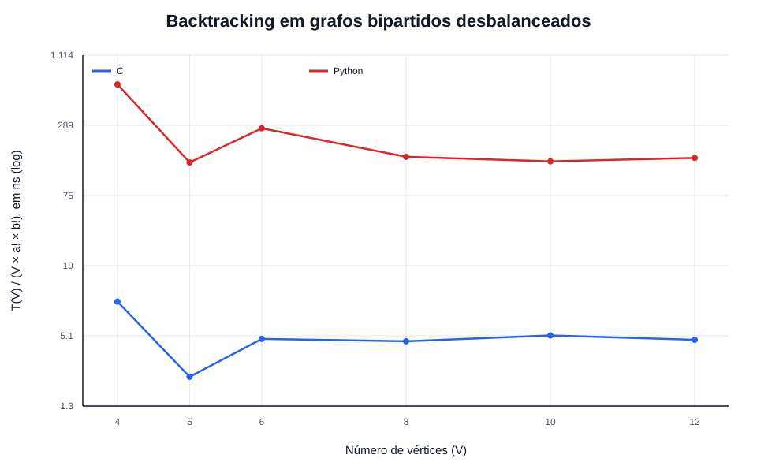
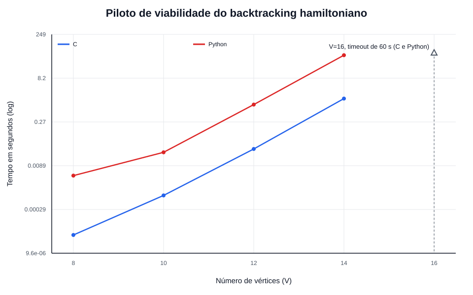
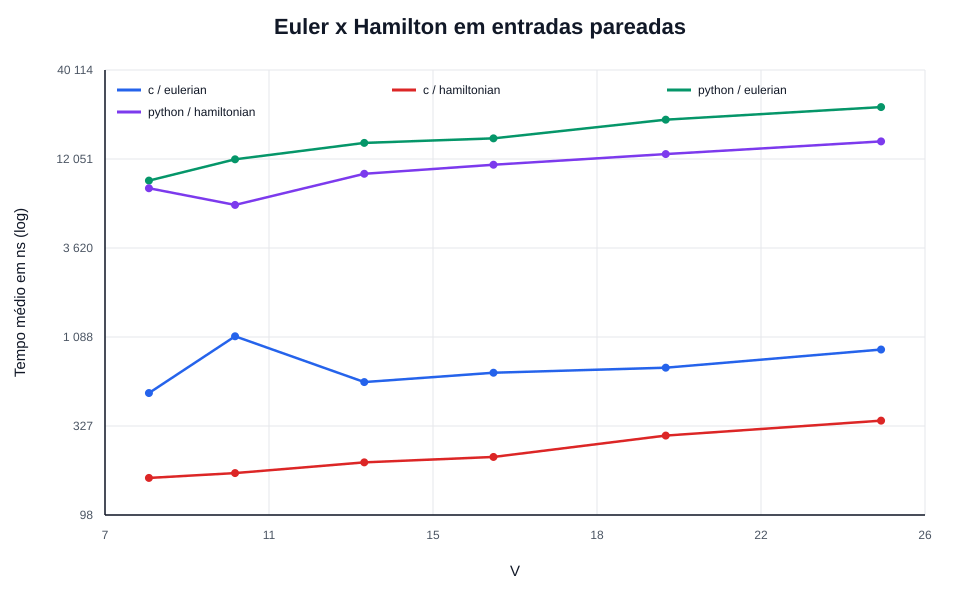
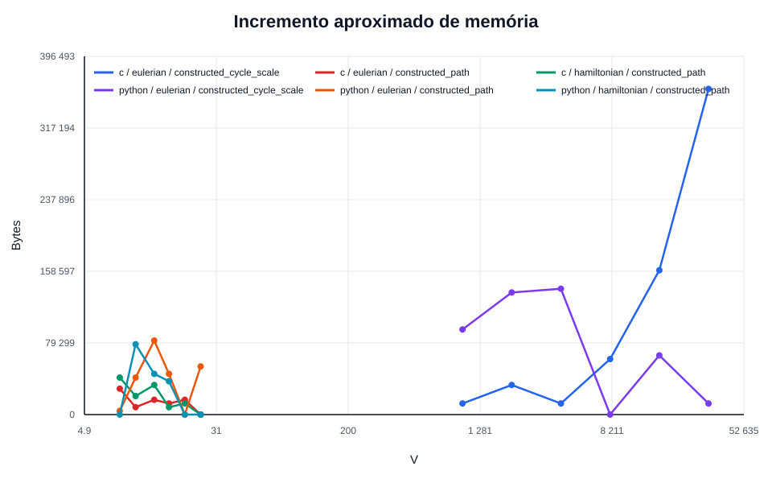

# Caminho Euleriano x Caminho Hamiltoniano

## 1. Descrição do problema e dos algoritmos

### 1.1 Escopo e modelo de entrada

O trabalho compara dois problemas sobre grafos simples e não direcionados. Os vértices são identificados pelos inteiros de `0` a `V-1` e as arestas são pares não ordenados. Os mesmos arquivos de grafo são consumidos pelas implementações em C17 e Python. Em C, as estruturas usam vetores alocados explicitamente; em Python, listas e tuplas representam os mesmos dados e preservam a mesma ordem determinística de vizinhos.

O formato textual adotado começa com `TC_GRAPH 1`, seguido por `V`, `E`, `SEED`, `FAMILY`, `CASE`, pelo marcador `EDGES` e por `E` pares de vértices. Laços, arestas repetidas, vértices fora do intervalo e divergência entre `E` e a quantidade lida são rejeitados. A saída é um objeto JSON com o problema, existência, caminho testemunha, resultado da autovalidação, contadores, metadados e um campo reservado para tempo.

Como os problemas são diferentes, a equivalência de corretude é verificada entre as duas linguagens para cada problema. Não se espera que um grafo tenha necessariamente a mesma resposta para Euler e Hamilton.

### 1.2 Caminho euleriano e algoritmo de Hierholzer

Um caminho euleriano percorre cada aresta exatamente uma vez; vértices podem se repetir. Em um grafo não direcionado, desconsiderando vértices isolados, ele existe quando todos os vértices de grau não nulo pertencem ao mesmo componente e existem zero ou dois vértices de grau ímpar. Com dois ímpares, o caminho começa em um deles; com zero, obtém-se um circuito euleriano.

Pseudocódigo da implementação:

```text
HIERHOLZER(G):
    se V = 0: retorne o caminho vazio
    se E = 0: retorne [0]
    conte os componentes que possuem arestas
    liste os vértices de grau ímpar
    se houver mais de um componente ativo ou a quantidade de ímpares não for 0 nem 2:
        retorne inexistente
    escolha o menor vértice ímpar; se não houver, o menor vértice com aresta
    pilha <- [início]
    enquanto pilha não estiver vazia:
        v <- topo da pilha
        se v possuir aresta ainda não usada:
            marque a aresta e empilhe a outra extremidade
        senão:
            remova v da pilha e acrescente-o ao caminho invertido
    inverta o caminho
    aceite somente se exatamente E arestas foram usadas e o caminho tiver E+1 vértices
```

Cada incidência armazena um identificador de aresta, evitando que a mesma aresta não direcionada seja usada duas vezes. A ordem crescente dos vizinhos torna a testemunha determinística nas duas linguagens.

### 1.3 Caminho hamiltoniano e backtracking

Um caminho hamiltoniano visita cada vértice exatamente uma vez; não é necessário usar todas as arestas. A implementação tenta cada vértice como origem e expande recursivamente apenas vizinhos ainda não visitados. Quando uma escolha não pode ser completada, ela é desfeita.

```text
HAMILTON(G):
    para início de 0 até V-1:
        caminho <- [início]
        marque início
        se BUSCA(início): retorne caminho
    retorne inexistente

BUSCA(v):
    conte o estado explorado
    se tamanho(caminho) = V: retorne verdadeiro
    para cada vizinho u de v, em ordem crescente:
        se u não estiver marcado:
            marque u e acrescente-o ao caminho
            se BUSCA(u): retorne verdadeiro
            remova u e desmarque u
    retorne falso
```

Além da autovalidação de cada executável, os testes usam validadores externos. Para grafos pequenos, um oráculo independente verifica a condição euleriana e outro enumera caminhos hamiltonianos, sem reutilizar a implementação avaliada.

## 2. Classificação assintótica

### 2.1 Hierholzer

A análise começa com o grafo carregado. Se `E=0`, a função consulta os tamanhos do grafo e retorna imediatamente, em tempo `Theta(1)`. Nas entradas com arestas, a verificação de conectividade percorre os `V` vértices e as `2E` incidências. A contagem de graus percorre `V` listas. Quando existe caminho, a construção mantém um cursor por vértice e avança sobre cada incidência no máximo uma vez. A inversão final tem no máximo `E+1` elementos. Para `E>0`, portanto:

- limite superior: `O(V + E)`;
- limite inferior: `Omega(V + E)`, pois a rotina examina os vértices e as incidências antes de decidir se existe caminho;
- limite justo: `Theta(V + E)`.

O grafo ocupa `Theta(V + E)`. Fora da entrada, os vetores de vértices visitados e cursores ocupam `Theta(V)`. As marcas de arestas ocupam `Theta(E)), e a pilha e o caminho possuem até `E+1` posições. O espaço auxiliar no pior caso é `Theta(V + E)`. Se `E=0`, o espaço auxiliar é `Theta(1)`. O espaço total, incluindo a entrada, é `Theta(V + E)` para grafos não vazios.

### 2.2 Backtracking hamiltoniano

Cada chamada recursiva corresponde a um prefixo de uma permutação. Para comprimento `k`, há no máximo `P(V,k) = V!/(V-k)!` prefixos. A soma para `k=1,...,V` é `V!` vezes uma soma parcial da série de `e`, logo o número de chamadas é `O(V!)`. Cada chamada pode examinar até `V-1` vizinhos, e reinicializar as marcas para todos os vértices iniciais custa no máximo `O(V²)`. Assim, `O(V × V!)` é um limite superior para o pior caso geral.

Para justificar o crescimento no caso difícil, considere os bipartidos completos `K(a,b)` da campanha, com `V=a+b` e `b-a` igual a 2 ou 3. Como um caminho alterna entre as partes, o algoritmo esgota os prefixos sem encontrar solução. Só os prefixos de comprimento `2a+1` iniciados na parte maior já somam `a! × P(b,a+1) = a! × b! / (b-a-1)!`, que é `Omega(a! × b!)`. Para o limite superior, cada prefixo resulta da intercalação de uma sequência ordenada de cada parte, com no máximo duas escolhas de parte inicial. Somando as possibilidades de cada parte, o total é menor que `2e² × a! × b!`. Portanto, a busca visita `Theta(a! × b!)` estados nessa família. Como todo estado examina os `a` ou `b` vizinhos de seu último vértice e ambos os graus são `Theta(V)`, o tempo nessa família é `Theta(V × a! × b!)`. Isso também fornece um limite inferior fatorial para o pior caso geral. O contador `states_explored` mede as chamadas recursivas e permite comparar o trabalho de busca entre as duas linguagens.

O grafo usa `Theta(V + E)`. O caminho, o vetor de visitados e a pilha recursiva possuem profundidade máxima `V`, totalizando `Theta(V)` de espaço auxiliar além da entrada. O espaço total é, portanto, `Theta(V + E)`, apesar do tempo exponencial/fatorial.

## 3. Melhor caso, pior caso e caso médio

### 3.1 Hierholzer

O melhor caso é `Theta(1)` e ocorre quando o grafo carregado não tem arestas. Para `E>0`, a varredura da representação dá tempo `Theta(V + E)` tanto nos casos aceitos quanto nos rejeitados. Assim, o pior caso tem esse limite, que também vale como caso médio para distribuições condicionadas a `E>0`. Ciclos e caminhos construídos exercitam casos positivos. Estrelas com mais de dois graus ímpares e componentes separados exercitam rejeições. A suíte de corretude cobre o retorno antecipado com os grafos vazio e unitário.

Na suíte de ciclos, `V` e `E` cresceram juntos de 1.000 para 32.000. A razão `T/(V+E)` permaneceu entre 10,38 e 18,59 ns em C e entre 477,82 e 539,02 ns em Python. As inclinações da regressão log-log foram 1,1718 e 0,9726, respectivamente, compatíveis com crescimento aproximadamente linear dentro da faixa medida. Isso confronta a previsão `Theta(V+E)` sem tratar a regressão como substituta da prova.

### 3.2 Backtracking hamiltoniano

- **Melhor caso.** Para `V>0`, a inicialização das marcas já custa `Omega(V)`. No caminho construído e ordenado, a primeira tentativa encontra a testemunha em `V` estados e examina no máximo dois vizinhos por estado. O tempo do melhor caso é, portanto, `Theta(V)`.
- **Pior caso.** Uma entrada com grande ramificação e sem solução força a exploração de muitos prefixos. Os bipartidos desbalanceados `K(a,b)` com diferença de 2 ou 3 entre as partes exercitam esse comportamento e têm o limite justo demonstrado no item 2.
- **Caso médio.** Depende da distribuição dos grafos, da densidade e da ordem dos vizinhos. A campanha usou uma instância `G(n,0,5)` por tamanho, com semente determinada, e separou o tempo e `states_explored` por família. As repetições de tempo medem a variabilidade da execução da mesma instância.

Os casos forçados confirmaram a diferença entre famílias. Nos caminhos construídos, `states_explored = V`, de 8 a 25. Nos bipartidos desbalanceados, o contador passou de 2.288 estados em `V=8` para 1.924.032 em `V=12` e 92.353.646 em `V=14`. Já os grafos `G(n,0,5)` foram não monotônicos: 620 estados em `V=13`, mas apenas 25 em `V=25`, porque a instância maior encontrou cedo uma testemunha na ordem determinística. Portanto, os dados aleatórios descrevem somente a distribuição e as sementes declaradas, não um caso médio universal.

## 4. Aplicabilidade prática

Caminhos eulerianos modelam tarefas que precisam processar conexões uma única vez, como inspeção de ruas, planejamento de rotas sobre trechos e reconstrução de sequências a partir de sobreposições. Hierholzer é adequado mesmo para grafos grandes, pois cresce linearmente com a representação.

Caminhos hamiltonianos modelam visitas únicas a locais ou estados e aparecem como subestrutura em problemas de roteamento e sequenciamento. O backtracking exato é apropriado para instâncias pequenas, ensino, validação de heurísticas e casos com poda suficiente. Para grafos grandes, seu crescimento torna necessários algoritmos especializados, programação dinâmica, solvers ou heurísticas, conforme o objetivo.

Os dois problemas ilustram que pequenas mudanças no requisito - usar cada aresta uma vez ou visitar cada vértice uma vez - podem alterar profundamente a tratabilidade computacional.

## 5. Simulação com dados reais ou sintéticos

### 5.1 Entradas congeladas

O gerador `tools/generate_experiments.py`, com semente base `20261117`, produziu 29 grafos registrados em `datasets/experimental-manifest.json`, que contém o SHA-256 do gerador e de cada entrada. A suíte pareada possui 18 grafos, com seis tamanhos por família:

- caminho construído favorável: `8, 10, 13, 16, 20, 25`;
- `G(n,0,5)` aleatório: `8, 10, 13, 16, 20, 25`;
- bipartido completo desbalanceado desfavorável: `4, 5, 6, 8, 10, 12`.

As quatro combinações algoritmo-linguagem receberam exatamente os mesmos 18 arquivos. O piloto usou a família bipartida em `V = 8, 10, 12, 14, 16`. A suíte suplementar de Hierholzer usou ciclos com `V = E = 1.000, 2.000, 4.000, 8.000, 16.000, 32.000`; ela não foi apresentada como comparação direta com Hamilton.

### 5.2 Protocolo executado

Cada ponto final de tempo possui 20 repetições válidas. Antes de cada repetição medida, o mesmo processo executou três rodadas preliminares não contabilizadas para estabilização de caches. O CPython estava com o JIT experimental desativado. Operações rápidas foram executadas em lotes calibrados; o CSV preserva o tempo total bruto e o tempo inteiro por chamada.

O arquivo é carregado e validado antes do cronômetro. Em C, o Windows usa `QueryPerformanceCounter`; a alternativa Linux/WSL usa `clock_gettime(CLOCK_MONOTONIC)`. Python usa `time.perf_counter_ns()`. Somente as chamadas de Hierholzer ou do backtracking ficam entre início e fim; validação da resposta, serialização JSON e escrita do CSV ocorrem depois. Um processo externo aplica timeout de 60 segundos e registra separadamente `completed`, `failed`, `invalid` ou `timeout`. Timeout é dado censurado, não uma duração igual a 60 segundos.

O CSV bruto de tempo preserva timestamp, commit, linguagem, problema, dataset, família, caso, semente, `V`, `E`, densidade, repetição, rodadas preliminares, lote, nanossegundos totais e por chamada, contadores do algoritmo, resposta, validade, status e timeout.

Foram preservadas 1.440 linhas pareadas e 240 linhas da escala de Hierholzer, todas válidas e sem timeout. O piloto preserva oito conclusões e dois timeouts. Em ambas as linguagens, `V=14` concluiu - 1,669 s em C e 49,173 s em Python - e `V=16` foi censurado aos 60 s. Assim, `V=14` foi o maior tamanho difícil observado como viável no limite adotado; timeout não foi convertido em tempo igual a 60 s.

### 5.3 Memória e regra de exclusão

A memória é medida separadamente do tempo porque criar e observar processos adiciona sobrecarga que não pertence ao algoritmo. No Windows, cada repetição inicia diretamente o executável C ou o executável real do Python e registra `PeakWorkingSet64` e `PeakPagedMemorySize64`. São usados 15 processos novos para o baseline, que apenas carrega e monta o grafo, e 15 para o algoritmo. O resumo apresenta média, mediana e desvio-padrão amostral, além do incremento aproximado `max(0, mediana_algoritmo - mediana_baseline)`.

O working set inclui a entrada, bibliotecas e, no caso de Python, o interpretador. Por isso, o pico absoluto e o incremento são analisados em conjunto com `Theta(V+E)` de espaço total; o incremento não é tratado como medição exata do heap do algoritmo.

Foram preservadas 720 linhas de memória pareada e 360 da escala de Hierholzer, sem falhas ou timeouts. Para tempo, a análise aceita somente `status=completed`, `valid=true` e `timeout=false`; para memória, exige processo concluído, não censurado e pico disponível. Nenhum outlier válido foi removido. Os CSVs brutos, resumos e hashes de análise estão em `results/raw/`, `results/summary/` e `results/analysis-manifest.json`.

## 6. Gráficos e tabelas de comparação

### 6.1 Teórico x medido

O gráfico `results/charts/euler_time_loglog.svg` mostra as duas linguagens contra `V+E`; `results/charts/euler_ratio.svg` mostra `T/(V+E)`. A relativa estabilidade da razão e as inclinações próximas de 1 sustentam empiricamente a tendência linear de Hierholzer. A tabela abaixo apresenta os extremos da suíte; cada valor é média de 20 repetições.

| Linguagem | V = E | Média | Desvio-padrão | T/(V+E) |
|---|---:|---:|---:|---:|
| C | 1.000 | 20.751 ns | 2.020 ns | 10,38 ns |
| C | 32.000 | 1.189.560 ns | 273.066 ns | 18,59 ns |
| Python | 1.000 | 1.078.036 ns | 239.183 ns | 539,02 ns |
| Python | 32.000 | 30.923.825 ns | 3.223.841 ns | 483,18 ns |


Para Hamilton, `results/charts/hamilton_states.svg` e `results/charts/hamilton_time.svg` separam as famílias. No caso desfavorável, estados e tempo cresceram rapidamente:

| Linguagem | V | Estados | Média | Desvio-padrão |
|---|---:|---:|---:|---:|
| C | 8 | 2.288 | 0,026 ms | 0,002 ms |
| C | 10 | 54.970 | 0,880 ms | 0,058 ms |
| C | 12 | 1.924.032 | 34,000 ms | 3,139 ms |
| Python | 8 | 2.288 | 0,910 ms | 0,096 ms |
| Python | 10 | 54.970 | 24,997 ms | 1,250 ms |
| Python | 12 | 1.924.032 | 1.122,373 ms | 435,931 ms |


Para confrontar o modelo teórico com as medições, o gráfico a seguir divide o tempo médio por `f(V)=V × a! × b!`, o limite justo obtido no item 2 para a família bipartida. Entre `V=8` e `V=12`, a razão varia de 4,55 a 5,09 em C e de 144,66 a 157,93 em Python, em nanossegundos por unidade de `f(V)`. A relativa estabilidade nesse intervalo é compatível com o modelo. As instâncias menores exibem mais variação, em especial `V=5`, cuja diferença entre as partes é 3. Na família aleatória, o número de estados depende de quando a ordem de vizinhos encontra uma testemunha, o que explica a curva não monotônica.



O gráfico do piloto mostra as execuções individuais até `V=14` e marca `V=16` com um triângulo no limite de 60 s para as duas linguagens. O triângulo indica censura pelo limite externo. Em `V=14`, os tempos observados foram 1,669 s em C e 49,173 s em Python.



### 6.2 Algoritmo x algoritmo e C x Python

`results/charts/paired_algorithms.svg` compara os algoritmos somente nos mesmos caminhos construídos. Em `V=25`, C mediu 918 ns para Euler e 351 ns para Hamilton; Python mediu 24.304 ns e 15.287 ns. O backtracking favorável pode ser mais rápido nesse intervalo porque segue imediatamente uma sequência de `V` estados, apesar de possuir pior caso muito superior. O contraste com a família bipartida mostra por que uma medição apenas favorável seria enganosa.

`results/charts/language_ratio.svg` usa a razão C/Python. Em `V=25`, ela foi 0,0378 para Euler e 0,0230 para Hamilton, equivalentes a Python aproximadamente 26 e 44 vezes mais lento nessas instâncias. A diferença é de constante e representação; não altera as classes assintóticas.

| Entrada pareada | Algoritmo | Média em C | Média em Python |
|---|---|---:|---:|
| Caminho, V=25 | Hierholzer | 918 ns | 24.304 ns |
| Caminho, V=25 | Backtracking | 351 ns | 15.287 ns |
| Bipartido desbalanceado, V=12 | Hierholzer | 214 ns | 6.997 ns |
| Bipartido desbalanceado, V=12 | Backtracking | 34,000 ms | 1.122,373 ms |




### 6.3 Memória

`results/charts/memory_peak.svg` apresenta o pico absoluto e `results/charts/memory_increment.svg` o incremento aproximado sobre o baseline. Nos ciclos, o pico médio de C cresceu de 4.001.246 bytes em `V=1.000` para 6.887.014 em `V=32.000`; Python cresceu de 18.788.352 para 39.030.238 bytes. A tendência é coerente com espaço total `Theta(V+E)` e evidencia o custo maior de objetos e do interpretador Python.

O incremento é mais ruidoso e às vezes zero porque é a diferença entre medianas de processos distintos, arredondada pela granularidade do working set. Por isso, ele é diagnóstico complementar, não prova isolada de espaço auxiliar. Médias, medianas, desvios, mínimos e máximos completos estão em `results/summary/timing.csv` e `results/summary/memory.csv`.




## 7. Reflexão sobre P e NP

O problema de decisão associado ao Caminho Euleriano pertence a **P**. Em um grafo não direcionado, basta verificar conectividade entre os vértices de grau não nulo e contar quantos graus são ímpares. As duas operações custam `O(V+E)`. Se a resposta for positiva, Hierholzer também constrói uma testemunha em `Theta(V+E)`. Portanto, tanto decidir a existência quanto produzir o caminho são tratáveis em tempo polinomial — neste caso, linear no tamanho da representação por listas de adjacência.

O Caminho Hamiltoniano de decisão pertence a **NP**. Um certificado é uma sequência com `V` vértices. Um verificador confere em tempo polinomial se a sequência tem exatamente `V` elementos, se cada vértice aparece uma única vez e se todo par consecutivo forma uma aresta. Com uma tabela de adjacência ou marcação adequada, essa verificação custa `O(V+E)`; mesmo uma implementação ingênua permanece polinomial.

Além disso, Caminho Hamiltoniano em grafos não direcionados é **NP-completo**. O pertencimento a NP foi demonstrado acima. Para a dificuldade, pode-se reduzir em tempo polinomial o problema do Ciclo Hamiltoniano, reconhecidamente NP-completo: escolhe-se um vértice `v`, substitui-se `v` por duas cópias com a mesma vizinhança e conecta-se uma nova folha a cada cópia. Qualquer caminho hamiltoniano precisa começar e terminar nessas folhas; removendo-as e reunindo as cópias, obtém-se um ciclo hamiltoniano no grafo original. No sentido inverso, cortar um ciclo em `v` produz o caminho entre as duas cópias. Logo, uma solução polinomial geral para Caminho Hamiltoniano implicaria uma solução polinomial para Ciclo Hamiltoniano.

A diferença estrutural explica o contraste observado. No problema euleriano, restrições locais de grau e conectividade caracterizam completamente a existência; depois de usar uma aresta, Hierholzer pode removê-la sem precisar reconsiderar escolhas globais. No problema hamiltoniano, exigir que cada vértice apareça exatamente uma vez cria uma ordem global: uma escolha local válida pode impedir todas as continuações, obrigando o algoritmo a desfazer decisões.

O backtracking usado neste trabalho é exato e adequado para demonstrar essa explosão combinatória, mas não torna o problema tratável em geral. Programação dinâmica por subconjuntos reduz o limite para aproximadamente `O(V^2 2^V)`, ainda exponencial; branch-and-bound, SAT, programação inteira e heurísticas podem ampliar os casos práticos sem eliminar o pior caso. Para a versão de decisão não existe uma “aproximação” que substitua a resposta exata: uma heurística pode encontrar e certificar um caminho, mas falhar em encontrá-lo não certifica inexistência. Aproximações fazem mais sentido em problemas de otimização relacionados, como variantes do Caixeiro Viajante sob hipóteses específicas.

Os experimentos tornam a distinção concreta sem constituírem prova de complexidade. Hierholzer foi medido até `V=32.000`, coerente com crescimento linear, enquanto o caso hamiltoniano bipartido difícil concluiu em `V=14` e atingiu o timeout de 60 segundos em `V=16` nas duas linguagens. Trocar C por Python altera constantes e memória, mas não muda a classe de complexidade nem remove a barreira combinatória.

## Ambiente de execução

O manifesto experimental gerado com a campanha registra timestamp, commit, estado da árvore versionada, CPU, RAM, Windows, modo de energia, PowerShell, executáveis, versões e timers. O ambiente possui Intel Core i7-7700HQ, 17.033.236.480 bytes de RAM e Windows NT build 26200 em modo Equilibrado. C17 foi compilado com GCC 16.2.0 e flags `-std=c17 -O2 -Wall -Wextra -Wpedantic`; Python 3.14.10 usou CPython com JIT experimental desativado.

## Contribuições dos integrantes

Os dados abaixo precisam ser substituídos pelos nomes e pelas contribuições reais antes da exportação do PDF final. Eles não foram inventados durante a automação do projeto.

| Integrante | Contribuições verificadas pelo grupo |
|---|---|
| `Lucca Rissato` |
| `Marco Aurelio` |
| `Luiz Gonzaga` |
| `Bernardo Guimarães` |
| `Igor Gabriel` |

## Declaração de uso de IA

Foi utilizado OpenAI Codex como apoio no planejamento, criação e refatoração das implementações para C17 e Python, elaboração dos testes automatizados, instrumentação de tempo e memória, geração dos datasets, execução assistida da campanha, criação dos gráficos SVG, análise estatística e redação preliminar deste relatório. O grupo deve revisar, compreender e ser capaz de explicar todo o código, os dados e a análise antes da entrega.

## Referências

1. BONDY, J. A.; MURTY, U. S. R. *Graph Theory*. Springer, 2008.
2. CORMEN, T. H. et al. *Introduction to Algorithms*. 4. ed. MIT Press, 2022.
3. GAREY, M. R.; JOHNSON, D. S. *Computers and Intractability: A Guide to the Theory of NP-Completeness*. W. H. Freeman, 1979.
4. KARP, R. M. Reducibility among combinatorial problems. In: MILLER, R. E.; THATCHER, J. W. (org.). *Complexity of Computer Computations*. Plenum Press, 1972. p. 85-103.
5. MICROSOFT. *Process.PeakWorkingSet64 Property*. Microsoft Learn.
6. PYTHON SOFTWARE FOUNDATION. *time - Time access and conversions*. Python 3 documentation.
